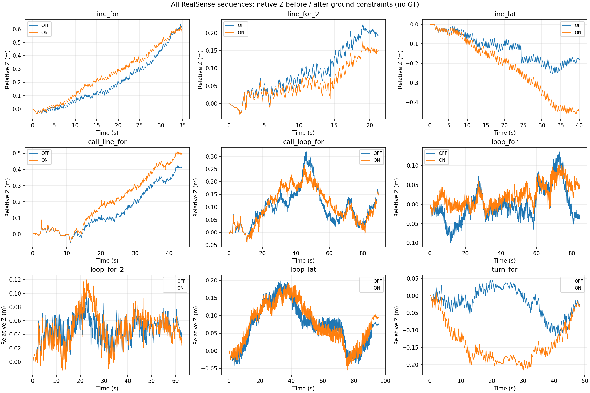
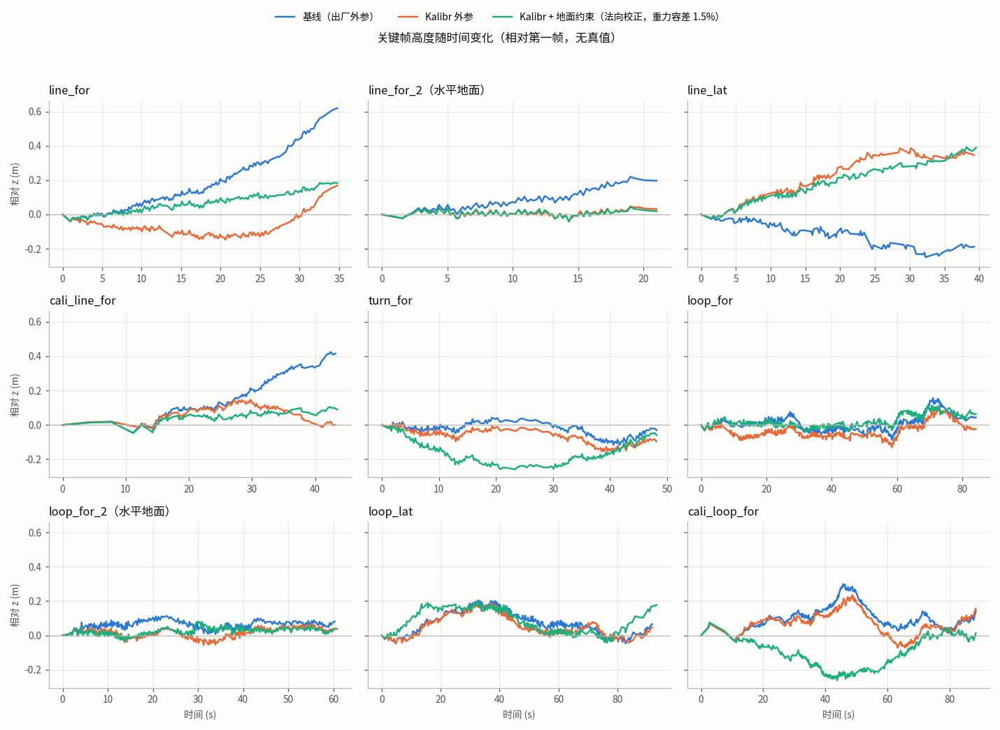

# RealSense 数据集 z 轴漂移：地面约束诊断、Kalibr 标定与改进实验

- 日期：2026-10-15 ~ 2026-10-17
- 分支：`SPLG`
- 设备：RealSense D435i（同一台），双目红外 848×480 @ 30 Hz，陀螺仪 200 Hz，加速度计 100 Hz
- 数据：`datasets/realsense/` 下 9 段 SLAM 录制和 1 段 Kalibr 标定录制，下载方式见第 9 节

## 1. 摘要

- **问题**：在 realsense 数据集上，新加的地面平面约束基本修不回 z 轴漂移；有几条序列打开约束后反而更差。
- **根因 1**：地面因子对"整张地图加平面一起倾斜"不敏感。平面坡度是自由变量，坡度先验 σ 只有 5°。而 z 漂移的 85–90% 恰好就是这种整体倾斜：世界坐标系 +Z 和真实地面法向差了约 1°。
- **根因 2**：IMU→相机外参从来没有标定过，tf_static 里的旋转只是出厂标称的单位阵。Kalibr 标定后，它和真实值差 1.04°。在前向直线运动中，VIO 分不开重力倾斜和加速度计零偏，这个外参误差会直接变成地图倾斜。
- **已修复**：Kalibr 外参写入配置后，9 条序列的平均 z 范围从 0.302 m 降到 0.227 m。前向直线序列的终点 z 漂移减少 73–100%。两条确认水平的序列（line_for_2、loop_for_2）的 z 范围降到 0.085 / 0.125 m，和手持晃动（5–8 cm）同一量级。
- **其他发现**：
  - 深度测得的地面法向在相机坐标系里固定偏了约 +0.45° 俯仰。已加入可选的校正参数 `ground_plane.normal_bias_deg`，默认为 0。
  - IMU 与图像的时间偏移会随曝光变化，因为图像时间戳打在曝光结束时。
  - IMU 初始化的 VIBA2 会接受模长误差 3–7% 的重力解，这是结果不稳定的主要来源。
- **仍未解决**：
  - 停车场序列还有 0.1–0.4 m 的竖直起伏，没有真值，分不清是地形还是漂移。
  - 地面约束的几种参数组合都没有带来稳定的整体收益。

## 2. 诊断：地面约束为什么修不回 z 漂移

诊断用的是 2026-10-15 的地面约束验证结果（`results/validation/ground_plane_20261015`）：



1. **因子确实生效了。** 每条序列有 109–328 个地面观测，没有一次求解被拒绝。
2. **相机离地高度几乎不变，"地面"却跟着相机一起升降。**
   - line_for：深度测得的相机离地高度始终在 1.11–1.19 m（5–95 分位范围 6 cm），而世界坐标系里的地面高度上升了 0.53 m，和相机 z 的相关系数为 0.99。
   - line_lat、cali_line_for、loop_lat、cali_loop_for 的相关系数也在 0.93–0.99。
   - 扣掉一个整体倾斜平面后，地面高度残差只剩 5–7 cm。
3. **这个倾斜对因子来说是"免费"的。** 平面参数 a、b、h（z = a·x + b·y + h）全是自由变量。把所有位姿和平面一起旋转，法向残差和距离残差都完全不变。唯一能约束倾斜的是坡度先验 `gravity_sigma_deg = 5°`：line_for 上 0.69° 的倾斜只产生 0.0095 的代价，而最终 BA 的总代价是 7134。
4. **验证（旧外参，line_for）：** 只把坡度先验收紧到 0.05°，z 范围就从 0.657 m 降到 0.090 m。说明问题确实出在坡度自由度上。不过这个做法等于假设地面水平，室外停车场的真实坡度也会被一起压平。

## 3. 修改内容

### 3.1 本次新增或修改的内容

| 文件 | 内容 | 影响 |
|---|---|---|
| `configs/realsense_current_stereo_imu.yaml` | `imu.t_cam0_body_override` 改为 Kalibr 标定的 IMU→cam0 外参，并加注释说明来源。`time_offset_ms` 保持 8.0（原因见 5.3） | 用这份配置建图时，外参旋转换成标定值（和原来差 1.04°） |
| `scripts/localize_plan_loop.py` | `load_imu_for_localizer()` 现在也读取 `t_cam0_body_override`，和 `build_map.py` 一致 | 定位和建图使用同一外参 |
| `src/splg_slam/mapping/ground_plane.py` | 新增 `GroundPlaneOptions.normal_bias_deg = (俯仰, 横滚)`，默认 `(0, 0)`，并校验必须是两个有限值、绝对值小于 5°。`detect_ground()` 选出地面后，在相机坐标系里把法向反向旋转掉这个偏差，并重算 `height_m`；实测质心不变，因为距离残差用的是质心 | 默认不生效 |
| `tests/test_ground_plane.py` | 新增 `test_normal_bias_is_removed_in_camera_frame` | 13 个测试全部通过 |
| `tools/kalibr_d435i/` | D435i 标定工具链：`rosbag2_to_kalibr.py`（rosbag2 转 ROS1 bag，IMU 线性插值合并，并做和 SLAM 相同的 IMU 内参修正）、`check_target.py`（标定板参数和录制质量预检）、`run_kalibr.sh`（一键标定）、`kalibr_to_splg.py`（结果转 SLAM 配置）、`aprilgrid.yaml`、`imu.yaml`、录制说明 `README.md` | 新工具 |
| `tools/kalibr_d435i/results/kalibr_d435i_20261015_224910/` | 这次标定的结果和报告（`kalibr-camchain-imucam.yaml`、`kalibr-results-imucam.txt`、`kalibr-report-imucam.pdf` 等） | 存档 |
| `docs/reports/2026-10-17_z_drift_ground_plane_kalibr/` | 本报告、图、实验配置和评估脚本、`metrics.json` | 存档 |
| `.gitignore` | 忽略 `tools/kalibr_d435i/runs/`，并把 `tools/kalibr_d435i/results/` 从 `results/` 规则中排除 | — |

### 3.2 一并提交的、此前已完成但未提交的地面约束功能

- 新文件：`src/splg_slam/data/ground_depth.py`（读取深度图并检查时间戳）、`src/splg_slam/mapping/ground_plane.py`（地面检测、关联和平面因子）、`tests/test_ground_plane.py`。
- 修改：`scripts/build_map.py`（接入检测流程，写出 `ground_planes.jsonl`）、`src/splg_slam/map/keyframe.py`（新增 `ground_plane` 字段）、`src/splg_slam/mapping/local_ba.py` 和 `pose_graph.py`（加入地面因子）、`README.md`，以及配置里的 `ground_plane:` 段。
- 地面约束默认是关闭的（`ground_plane.enabled: false`）。

## 4. Kalibr 标定

### 4.1 录制

- 标定板：AprilGrid 6×6（tag36h11），tag 边长 55 mm，间隙 16.5 mm（tagSpacing 0.3）。
- 录制设置：关闭红外投射器，不开深度和彩色流，IMU 不合并。录制命令和动作要领见 `tools/kalibr_d435i/README.md`。
- 第一次录制（2026-10-15 22:39，29.5 s）不可用：运动段每轴角速度 RMS 50–80°/s，曝光又长，6–21 s 内一帧 tag 都没检测到。
- 第二次录制 `kalibr_d435i_20261015_224910`（67.5 s）通过预检：每帧都能检测到 30–36 个 tag，约 36 s 运动段中角速度 7–26°/s，三个轴的旋转幅度分别为 31° / 67° / 28°。

### 4.2 结果

Kalibr 的双目内参标定在 cam0 焦距初始化时失败了（初值 4083，正常约 432），这是 Kalibr 的已知问题。cam1 初始化正常，和出厂内参只差 0.3%。D435i 的红外图像本来就在相机芯片上按出厂内参校正过，SLAM 用的也是出厂内参，所以相机-IMU 标定直接用出厂内参（`SKIP_CAM=1`）。

| 项目 | 结果 |
|---|---|
| 重投影误差 | cam0 / cam1 平均 0.20 px |
| IMU 残差（按噪声模型归一化） | 陀螺仪 0.48，加速度计 0.46 |
| 双目基线 | 50.31 mm，和出厂值一致，说明 tagSize 正确 |
| 旋转和 tf_static 的差 | 1.04°，在 cam0 坐标系下分解为 x（俯仰）0.47°、y（绕竖直轴）0.66°、z（横滚）0.65° |
| 平移和 tf_static 的差 | (0.27, −0.03, −2.13) mm |
| 时间偏移 | t_imu = t_cam − 4.98 ms。只对这次录制的曝光有效，见 5.3 |

```yaml
imu:
  t_cam0_body_override:
    - [0.999869169, -0.011286902, 0.011586623, 0.005790374]
    - [0.011381886, 0.999901889, -0.008164816, -0.005130029]
    - [-0.011493331, 0.008295625, 0.999899538, -0.013873123]
    - [0.0, 0.0, 0.0, 1.0]
```

## 5. 实验与改善

所有配置都用同一份代码和 `--seed 0`，单次运行。没有真值，"z 范围"指关键帧相对第一帧的最大最小高度差。z 范围对应的倾斜，在停车场序列里可能是真实坡度，在两条水平序列里则全部是误差。

### 5.1 z 范围（m）

| 序列 | 基线 | Kalibr | Kalibr + 地面（默认参数） | Kalibr + 地面校正 | Kalibr，容差 1.5% | Kalibr + 地面校正，容差 1.5% |
|---|---|---|---|---|---|---|
| line_for | 0.657 | 0.316 | 0.208 | 0.199 | 0.329 | 0.225 |
| **line_for_2（水平）** | 0.241 | **0.085** | 0.082 | 0.395 | **0.086** | **0.086** |
| line_lat | 0.249 | 0.409 | 0.433 | 0.296 | 0.519 | 0.415 |
| cali_line_for | 0.471 | 0.171 | 0.136 | 0.101 | 0.193 | 0.153 |
| turn_for | 0.160 | 0.169 | 0.228 | 0.259 | 0.169 | 0.259 |
| loop_for | 0.244 | 0.231 | 0.161 | 0.160 | 0.176 | 0.154 |
| **loop_for_2（水平）** | 0.113 | 0.125 | 0.097 | 0.106 | 0.125 | 0.121 |
| loop_lat | 0.251 | 0.233 | 0.473 | 0.308 | 0.265 | 0.240 |
| cali_loop_for | 0.328 | 0.307 | 0.222 | 0.181 | 0.305 | 0.337 |
| **平均** | **0.302** | **0.227** | 0.227 | 0.223 | 0.241 | 0.221 |

各列含义：

- **基线**：出厂外参（旋转为单位阵），地面约束关闭。
- **Kalibr**：只换外参，即当前仓库配置。
- **地面（默认参数）**：法向 σ 3°、距离 σ 0.06 m、坡度先验 σ 5°。
- **地面校正**：法向 σ 0.5°，`normal_bias_deg: [0.45, 0]`。
- **容差 1.5%**：`imu.reinit_gravity_tolerance: 0.015`，默认值是 0.08。

终点 z 漂移（m）：

| 序列 | 基线 | Kalibr |
|---|---|---|
| line_for | +0.619 | +0.169 |
| line_for_2 | +0.197 | +0.031 |
| cali_line_for | +0.416 | 0.000 |

沿行进方向拟合出的倾斜：基线为 0.47–0.67°，Kalibr 为 0.03–0.08°。



### 5.2 深度地面法向的固定偏差

用 `experiments/normal_bias.py` 做最小二乘，把深度地面法向和地图 +Z 的夹角拆成两部分：一部分固定在相机坐标系里（B），另一部分固定在世界坐标系里。只有转弯或绕圈的序列能把两者分开（Kalibr 外参，地图）：

| 序列 | B 俯仰 | B 横滚 | 世界系残余倾斜 |
|---|---|---|---|
| loop_for_2（水平） | +0.43° | +0.01° | 0.41°（这条噪声大，拟合残差 rms 1.3°） |
| loop_for | +0.36° | +0.19° | 0.14° |
| loop_lat | +0.34° | +0.42° | 0.34° |
| cali_loop_for | +0.51° | +0.13° | 0.21° |
| turn_for | +0.63° | +0.50° | 0.26° |

- 用水平序列定出的 B 去校正 line_for_2，沿行进方向的法向俯仰只剩 +0.04°，和轨迹本身 0.03° 的倾斜吻合。说明 Kalibr 外参下重力方向已经准到 0.1° 以内，剩下约 0.4° 的俯仰差来自深度法向。
- 一开始测到的约 1.2° 俯仰偏差，可以拆成：外参误差 0.47°，加上深度法向偏差约 0.43°，再加一点残差。
- 偏差大小相当于约 0.13 px 的视差零点偏移。深度误差随距离平方增长，会让地面法向产生俯仰偏差。
- 这个偏差解释了"法向 σ 0.5°、不做校正"那组实验为什么让 line_for 下降了 0.26 m：法向收紧后，相机姿态被这个偏差拉偏了约 0.4°。
- 同帧比较 D435 深度和 SGBM 双目各自算出的地面法向（`experiments/depth_vs_sgbm.py`）：SGBM 单帧噪声约 2°，无法判断偏差是出在 D435 的深度处理还是双目校正。

### 5.3 IMU 与图像的时间偏移随曝光变化

| 数据 | 曝光（中位数） | 估出的偏移 t_imu − t_cam |
|---|---|---|
| line_for、loop_for、loop_lat、cali_loop_for | 0.4–0.5 ms | +6.0 ~ +6.5 ms |
| turn_for | 10.9 ms | +1.0 ms |
| Kalibr 标定录制 | 未记录（推算约 20 ms） | −4.5 ~ −5.0 ms |

偏移大约按"曝光时间的一半"变化，说明图像时间戳打在曝光结束时，而画面对应的是曝光中点。所以 Kalibr 的 −5 ms 只适用于标定录制，不能写进 SLAM 配置；现有的 +8 ms 对室外数据大致合适。标定录制的 −4.5 ms 也用标定板 PnP 和陀螺仪做互相关独立核对过，Kalibr 的估计本身是对的。

### 5.4 地面因子的残差已经满足

固定最终地图的位姿、只重新拟合平面后：

- 距离残差在 1–2.5 cm 以内；
- 法向残差中位数 0.3–0.5°，就是测量噪声水平；
- 平面相对世界 +Z 倾斜 0.4–0.8°。

也就是说，剩下的起伏仍是"平面加地图"相对重力方向的整体倾斜。继续收紧法向 σ 或距离 σ 都碰不到它。

### 5.5 VIBA2 接受不可靠的重力解

VIBA 各阶段和周期重初始化共用 `imu.reinit_gravity_tolerance: 0.08`，允许 8% 的重力模长误差。在直线序列上，VIBA2 会接受模长误差 3–7% 的解，并给整张地图加 0.85–4.9° 的旋转。

- 例：line_for_2 的"地面校正"那组，VIBA2 误差 4.9%、旋转 1.47°，最终沿程倾斜变成 1.12°。
- 收紧到 1.5% 后，6/9 条序列的 VIBA2 被拒绝，line_for_2 恢复正常（0.086 m），但整体平均值没有变好。

单次运行本身是确定性的：配置相同时，结果逐位一致。但任何配置改动都会改变轨迹，进而改变后续的重初始化决策，结果会有 ±0.1 m 量级的变化。所以单次运行之间 0.1 m 以内的差异，不能直接归因于参数本身。

## 6. 改善总结

1. **Kalibr 外参（已写入配置）**：
   - 平均 z 范围从 0.302 m 降到 0.227 m（−25%）。
   - 前向直线序列的终点 z 漂移减少 73–100%。
   - 两条水平序列的 z 范围为 0.085 / 0.125 m，达到手持晃动的水平。
   - 环形序列基本不变：绕圈时的旋转让 VIO 能分开零偏和重力，原来就不太受外参误差影响。
2. **定位和建图使用同一外参。**
3. **可选的深度法向偏差校正**（默认关闭）：有物理依据，在 line_for、cali_line_for、loop_for、line_lat 上稳定变好，在 turn_for 上稳定变差，整体平均持平。
4. **可复用的标定流程和录制规范**：包括录制质量预检，以及曝光和时间戳问题的说明。

## 7. 仍存在的问题

1. **停车场序列的竖直起伏（0.1–0.4 m）没有真值，分不清是地形还是漂移。** line_lat 最明显：姿态是水平的，相机却爬升了 0.4–0.5 m，原因未明。
2. **地面约束仍无法约束整体倾斜。** 只要平面坡度是自由的，它就无法提供绝对重力信息；几种参数组合的平均 z 范围都在约 0.22 m。
3. **直线运动下的重力初始化条件差**（VIBA2 模长误差 3–7%），结果对配置改动敏感，单次运行比较不可靠。
4. **时间偏移固定为 8 ms 只是近似。** 每帧曝光在变化，turn_for 里在 3.6–15 ms 之间。
5. **深度法向偏差的来源未确认**（D435 视差零点偏移还是双目校正），偏差值只由两条序列定出。
6. **`localize_plan_loop.py` 的 IMU 处理和建图仍不一致**：没有应用 `time_offset_ms`、`gyro_scale` 和加速度计比例修正。
7. **Kalibr 双目内参标定未完成**，用的是出厂内参（cam1 初值和出厂值一致，可以佐证）。

## 8. 解决方案与建议

按优先级排列：

1. **把 `imu.reinit_gravity_tolerance` 改为 0.015。** 重力模长已知到 0.1%，误差 5% 的解本来就不该被接受。它能挡住 VIBA2 的坏解，整体平均值不受影响。
2. **修正定位脚本的 IMU 加载**，让 `localize_plan_loop.py` 和 `build_map.py` 一致（时间偏移、陀螺仪比例、加速度计比例）。
3. **建立竖直方向的评估基准**：在已知水平的地面上多录几段直线和绕圈；或者用水平仪、测斜仪实测停车场路线的坡度。之后每个配置用 3 个种子各跑一次再比较。
4. **曝光中点时间戳补偿**：用每帧 metadata 里的 `actual_exposure`，把图像时间戳改到 stamp − exposure/2，再统一用约 +6.5 ms 的偏移。录制时要带上 `infra*/metadata` 话题（标定 README 已更新）。
5. **处理深度法向偏差**：以后录数据前，先在相机上做 RealSense 片上标定和 Tare 标定；现有数据用 `normal_bias_deg: [0.45, 0]` 校正；再用已知几何的平板或墙面验证偏差来源。
6. **改进重力初始化**：只在旋转激励足够时才接受重初始化；在已知水平的场景里，把地面法向作为重力观测。
7. **如果使用场景可以假设地面水平**（例如平地上的 2D 导航）：打开地面约束，`gravity_sigma_deg` 设为 0.1–0.2°，同时设置 `normal_bias_deg`。注意真实坡度会被压平。

## 9. 数据集

9 段 SLAM 录制和 1 段 Kalibr 标定录制，都由同一台 D435i 录制，格式为 rosbag2（sqlite3），共 66 GB。下载地址是 GitHub Release
[`realsense-datasets-20261017`](https://github.com/Jiajun-Li-deepmirror/ORB_SLAM3/releases/tag/realsense-datasets-20261017)。

| 目录 | 时长 | 大小 | 说明 |
|---|---|---|---|
| line_for | 35.1 s | 4.4 GB | 室外停车场，向前直线 |
| line_for_2 | 21.3 s | 2.7 GB | 水平地面，向前直线 |
| line_lat | 40.2 s | 5.0 GB | 相机朝侧面，横向直线 |
| cali_line_for | 43.8 s | 5.4 GB | 向前直线 |
| turn_for | 48.3 s | 5.6 GB | 向前，带转弯 |
| loop_for | 84.3 s | 11 GB | 向前，绕圈 |
| loop_for_2 | 62.9 s | 7.7 GB | 水平地面，向前绕圈 |
| loop_lat | 95.5 s | 12 GB | 相机朝侧面，绕圈 |
| cali_loop_for | 89.3 s | 12 GB | 向前，绕圈 |
| kalibr_d435i_20261015_224910 | 67.5 s | 1.6 GB | AprilGrid 标定录制，没有深度流 |

GitHub Release 单个文件不能超过 2 GiB，所以每个目录都用 `tar | zstd -3` 打包后切成 1900 MiB 的分卷（`realsense_<目录>.tar.zst.partNN`）。校验和放在 `SHA256SUMS.txt`（分卷）和 `DB3_SHA256SUMS.txt`（解压后的 db3）里。还原方法：

```bash
sha256sum -c SHA256SUMS.txt --ignore-missing
mkdir -p datasets/realsense
cat realsense_line_for.tar.zst.part* | zstd -d | tar -x -C datasets/realsense/
(cd datasets/realsense && sha256sum -c ../../DB3_SHA256SUMS.txt --ignore-missing)
```

## 10. 复现

```bash
# 标定（Kalibr 镜像的构建方法见 tools/kalibr_d435i/README.md）
SKIP_CAM=1 BAG_FROM_TO="15 57" tools/kalibr_d435i/run_kalibr.sh datasets/realsense/kalibr_d435i_20261015_224910

# 对比实验：输出目录、运行脚本和评估脚本都在 experiments/ 里
#   run_suite.sh <variant ...>   需要 config_<variant>.yaml；DATASETS="a b" 可只跑部分序列
#   evaluate.py                  z 范围、沿程倾斜、地面法向与 +Z 夹角 -> metrics.json
#   normal_bias.py               拆分相机系固定偏差和世界系倾斜
#   plot_z.py                    生成 z_comparison.png
```

实验当时在 `results/validation/kalibr_extrinsic_20261015/` 下运行，每个配置的地图约 100–400 MB，没有纳入版本管理。`experiments/metrics.json` 是全部变体的指标，`experiments/evaluate_all_variants.log` 是汇总表。
